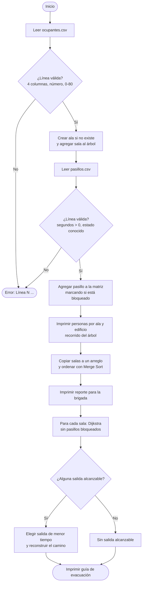
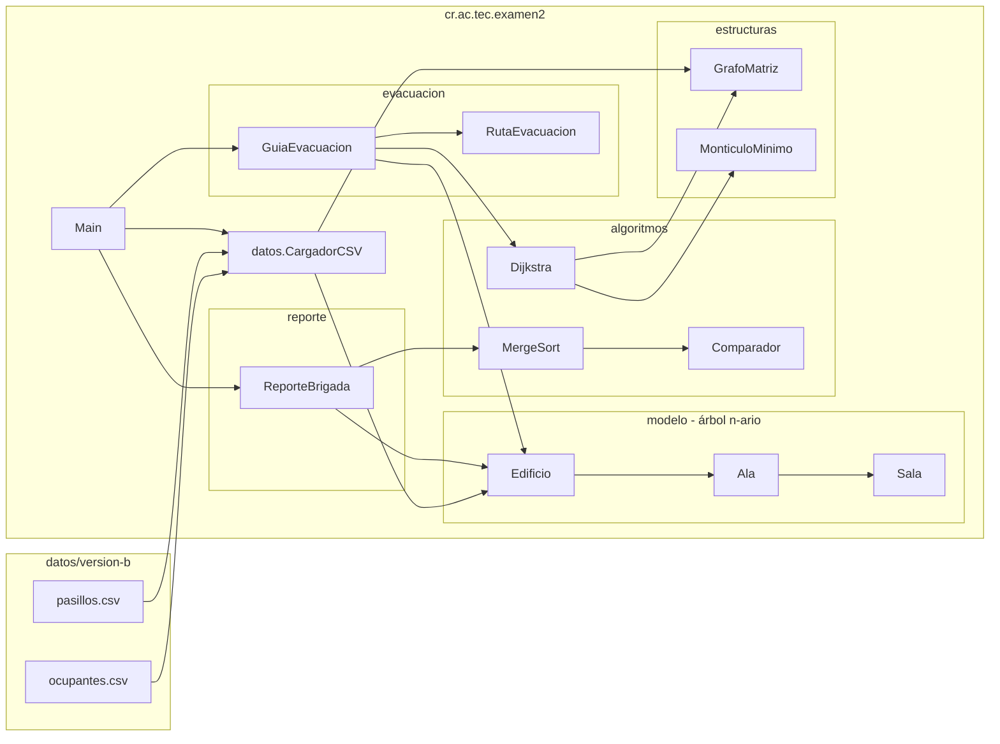
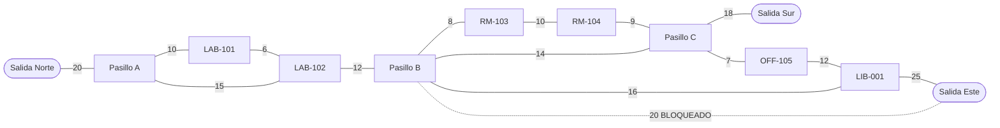

# Examen 2 – SalidaSegura: evacuación de un edificio (Versión B)

Algoritmos y Estructuras de Datos I (CE1103) – Instituto Tecnológico de Costa Rica – II Semestre 2026

## Autores

- José Sandí Arrieta
- Johan Jiménez Corella

## Requerimientos del sistema

Lista completa de la Parte 1, tal como fue presentada:

**F1**
- Árbol n-ario
- O(n) en búsqueda.
- Descartado AVL porque no se usan rangos.

**F2**
- Merge Sort
- O(n log n)
- Descartado Insertion porque no es estable. (en caso de empate)

**F3**
- Grafo con pesos, no dirigido usando Dijkstra y matriz de adyacencia
- O((V+E) log n)
- Descartado BFS porque se necesita el menor tiempo posible.

**Requerimientos funcionales :**

- RF - 1 (F1): el sistema tiene una estructura jerárquica que sigue el órden: edificio => ala => sala
- RF-2 (F1): El sistema puede ver la cantidad de personas por sala
- RF-3(F1): El sistema puede ver todas las salas de en ala
- RF-4 (F1): El sistema se actualiza cuando una persona entra o sale de una sala.
- RF-5 (F1): El sistema muestra la cantidad total de personas en ala y edificio.
- RF-6 (F2) El sistema muestra el total de las salas ordenadas de mayor a menor según la cantidad de personas en cada sala.
- RF -7 (F2) En caso de que varias salas tengan la misma cantidad de personas la siquiente llave de ordenamiento es de A a Z usando su código.
- RF -8 (F3): Desde cada sala se indica la ruta más rápida a seguir hacia cualquier salida
- RF - 9 (F3): El sistema indica cuarto tiempo tarda en segundos la ruta
- RF-10 (F3): En caso de que en pasillo este bloqueado no lo muestra como opcion válida.

**Requerimientos no funcionales:**

- RNF - 1: Máximo 80 personas por sala
- RNF - 2: Cada RF tiene una prueba unitaria

## Instalación y ejecución

Requisitos: **JDK 26** y **Maven 3.9+** (en macOS: `brew install maven`).

```bash
git clone https://github.com/jsandia/examen_02_datos1.git
cd examen_02_datos1/java
mvn compile                                    # compilar
java -cp target/classes cr.ac.tec.examen2.Main # ejecutar (lee ../datos/version-b)
mvn test                                       # ejecutar las pruebas unitarias
```

Opcionalmente se puede indicar otra carpeta de datos: `java -cp target/classes cr.ac.tec.examen2.Main ruta/a/carpeta`.

Verificación de restricciones (sin colecciones de `java.util` ni ordenamientos de biblioteca):

```bash
./scripts/verificar-restricciones.sh
```

### Salida del programa

```
=== Personas por ala y en todo el edificio ===
Oeste     54
Central   75
Este      51
Edificio 180

=== Reporte para la brigada ===
1. LIB-001  Biblioteca               Este     45
2. RM-103   Sala de clases           Central  45
3. LAB-102  Laboratorio de física    Oeste    30
4. RM-104   Sala de seminarios       Central  30
5. LAB-101  Laboratorio de química   Oeste    24
6. OFF-105  Oficina de docentes      Este      6

=== Guía de evacuación ===
LAB-101: Salida Norte en 30 s  [LAB-101 -> Pasillo A -> Salida Norte]
LAB-102: Salida Norte en 35 s  [LAB-102 -> Pasillo A -> Salida Norte]
RM-103: Salida Sur en 37 s  [RM-103 -> RM-104 -> Pasillo C -> Salida Sur]
RM-104: Salida Sur en 27 s  [RM-104 -> Pasillo C -> Salida Sur]
OFF-105: Salida Sur en 25 s  [OFF-105 -> Pasillo C -> Salida Sur]
LIB-001: Salida Este en 25 s  [LIB-001 -> Salida Este]
```

## Jerarquía de carpetas

```
examen_02_datos1/
├── datos/
│   ├── version-a/                 CSV de la versión A (no se usan)
│   └── version-b/
│       ├── ocupantes.csv          salas, ala y ocupantes
│       └── pasillos.csv           pasillos, segundos y estado
├── java/
│   ├── pom.xml                    proyecto Maven (Java 26, JUnit 5)
│   └── src/
│       ├── main/java/cr/ac/tec/examen2/
│       │   ├── Main.java
│       │   ├── modelo/            Edificio, Ala, Sala
│       │   ├── algoritmos/        Comparador, MergeSort, Dijkstra
│       │   ├── estructuras/       GrafoMatriz, MonticuloMinimo
│       │   ├── reporte/           ReporteBrigada
│       │   ├── evacuacion/        GuiaEvacuacion, RutaEvacuacion
│       │   └── datos/             CargadorCSV
│       └── test/java/cr/ac/tec/examen2/
│           ├── RF01..RF10*Test    una clase de pruebas por requerimiento funcional
│           ├── RNF01MaximoOcupantesTest
│           ├── CargadorCSVTest    datos mal formados
│           ├── SmokeTest          prueba del repositorio base
│           └── DatosPrueba        utilidades para cargar los CSV en las pruebas
├── scripts/verificar-restricciones.sh
├── .github/workflows/ci.yml       CI: mvn test + verificación de restricciones
├── README.md
└── PROMPTS.md
```

### Qué hace cada clase

| Clase | Paquete | Responsabilidad | Requerimientos |
|---|---|---|---|
| `Main` | raíz | Carga los CSV y ejecuta las tres corridas pedidas | todos |
| `Edificio` | `modelo` | Raíz del árbol n-ario. Agrega alas/salas, busca (O(n)), totales, entradas y salidas de personas | RF-1 a RF-5, RNF-1 |
| `Ala` | `modelo` | Nodo intermedio del árbol; arreglo dinámico propio de salas hijas | RF-1, RF-3, RF-5 |
| `Sala` | `modelo` | Hoja del árbol; código, nombre, ala y ocupantes (0 a 80) | RF-1, RF-2, RNF-1 |
| `Comparador` | `algoritmos` | Interfaz propia de comparación (reemplaza `java.util.Comparator`) | RF-6, RF-7 |
| `MergeSort` | `algoritmos` | Merge Sort propio, estable, O(n log n) peor caso | RF-6, RF-7 |
| `Dijkstra` | `algoritmos` | Camino más corto desde un origen, saltando pasillos bloqueados | RF-8 a RF-10 |
| `GrafoMatriz` | `estructuras` | Grafo con pesos, no dirigido, matriz de adyacencia + matriz de bloqueados | RF-8 a RF-10 |
| `MonticuloMinimo` | `estructuras` | Montículo binario de mínimos propio (cola de prioridad de Dijkstra) | RF-8, RF-9 |
| `ReporteBrigada` | `reporte` | Ordena todas las salas: ocupantes desc., código A-Z | RF-6, RF-7 |
| `GuiaEvacuacion` | `evacuacion` | Ruta a la salida más cercana para una sala o para todo el edificio | RF-8 a RF-10 |
| `RutaEvacuacion` | `evacuacion` | Resultado: sala, salida, camino y segundos | RF-8, RF-9 |
| `CargadorCSV` | `datos` | Lee `ocupantes.csv` y `pasillos.csv`, valida datos mal formados | RF-1, RF-10 |

Restricciones respetadas: solo arreglos y `String`; ninguna colección de `java.util`, ni `Arrays.sort`, `Collections.sort`, `List.sort` o `sorted()`; ninguna biblioteca de grafos. Las pruebas usan además JUnit 5.

## Requerimientos desarrollados por los estudiantes

| Requerimiento | Estado | Pruebas |
|---|---|---|
| RF-1 | Implementado | `RF01JerarquiaTest` |
| RF-2 | Implementado | `RF02PersonasPorSalaTest` |
| RF-3 | Implementado | `RF03SalasDeAlaTest` |
| RF-4 | Implementado | `RF04ActualizacionTest` |
| RF-5 | Implementado | `RF05TotalesTest` |
| RF-6 | Implementado | `RF06ReporteOrdenadoTest` |
| RF-7 | Implementado | `RF07DesempateTest` |
| RF-8 | Implementado | `RF08RutaMasRapidaTest` |
| RF-9 | Implementado | `RF09TiempoRutaTest` |
| RF-10 | Implementado | `RF10PasilloBloqueadoTest` |
| RNF-1 | Implementado | `RNF01MaximoOcupantesTest` |
| RNF-2 | Implementado | cada RF tiene su clase de pruebas (valor exacto, casos límite y entradas inválidas) |

Requerimientos excluidos: ninguno.

Decisiones de interpretación (sin modificar los requerimientos):
- RF-4: una entrada suma 1 y una salida resta 1; también se permite fijar los ocupantes de una sala (F1: "actualizar los ocupantes de una sala"). Salir de una sala vacía es un error.
- RF-8: las salidas son los nodos cuyo nombre empieza con "Salida". Si dos salidas empatan en tiempo, se elige la de nombre menor (A a Z). Si ninguna salida es alcanzable, no se devuelve ruta.
- RF-10: un pasillo cuyo estado empieza con "Bloqueado" se guarda en el grafo pero Dijkstra no lo recorre.

## Diagramas

### Diagrama de flujo



### Diagrama de componentes



### Diagrama del grafo (pasillos, segundos)

Grafo no dirigido con pesos. La línea punteada es el pasillo bloqueado (humo), que no se usa.


